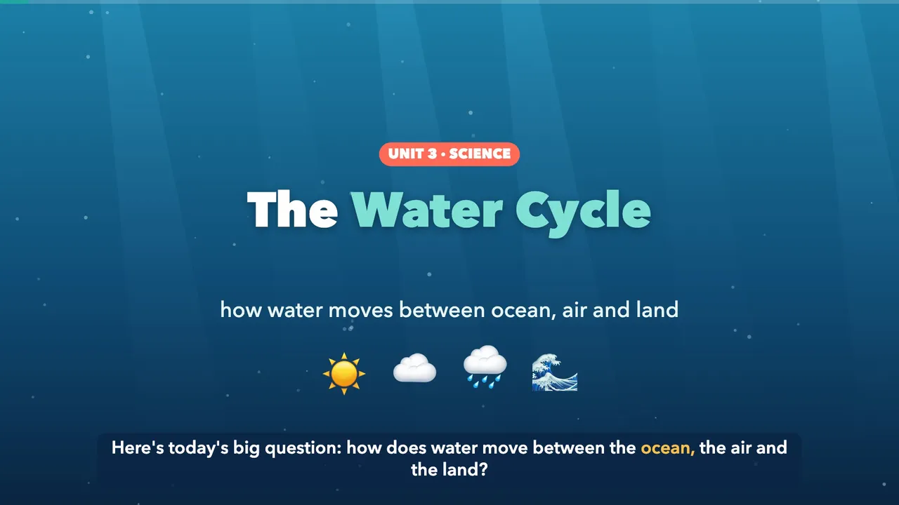
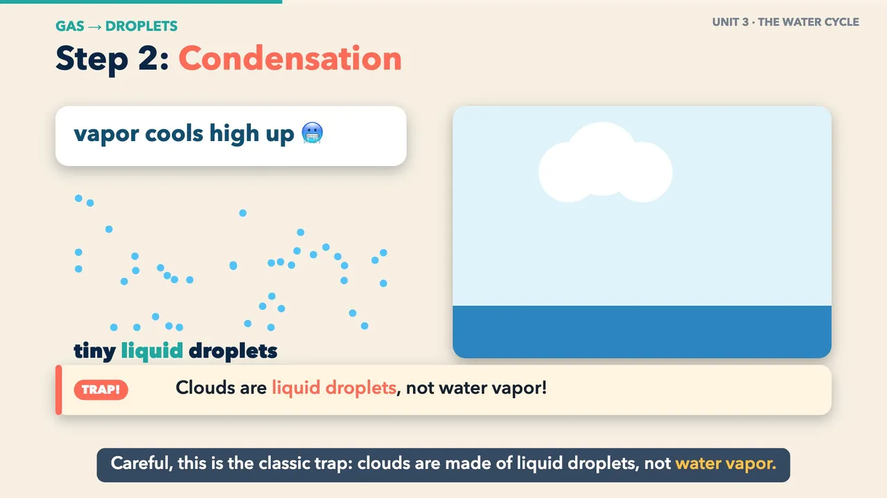
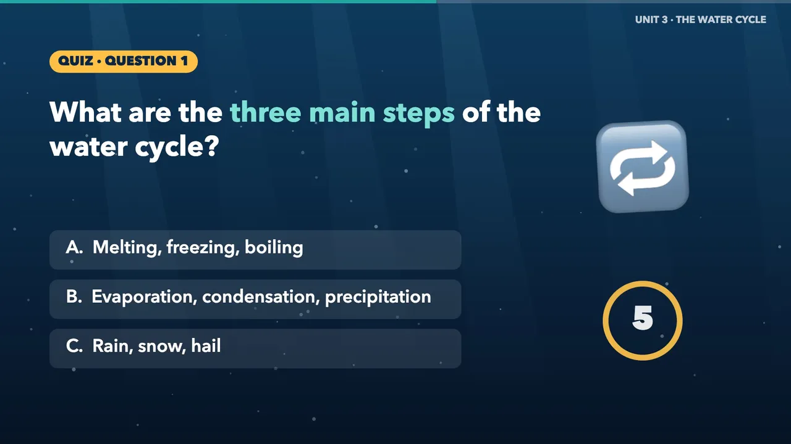
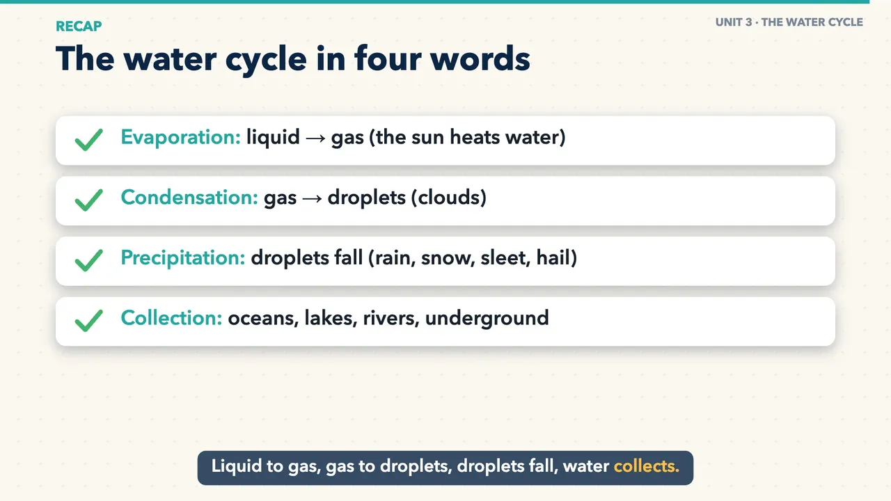

# lesson-videos

Turn your own slide deck into short narrated, animated study videos, one per chapter.

Students get to rewatch the lesson in your words: every definition, example and fact comes from your slides, never from the internet. Before building anything, Claude also lists places where your slides contradict each other or have typos, so you can fix them first.

## See a sample

| | |
|---|---|
|  |  |
|  |  |

**[▶ Watch the full sample video](https://github.com/DanielLandi/plugins/releases/download/lesson-videos-sample-v1/water-cycle-sample.mp4)** (2 minutes 21 seconds). Made from the six-slide [examples/water-cycle.pptx](../examples/water-cycle.pptx) with the free voice, no edits.

## What each video has

- A friendly narrator who explains each idea in your wording (a free voice, or ElevenLabs if you have an account).
- Animated diagrams and your own slide images, revealed in sync with the narration.
- Captions, "test tip" and "trap" callouts.
- A short pause-and-answer quiz and a recap.
- Optional background music and a few AI-animated clips made from your photos.

Videos are 4–6 minutes by default; you choose the length.

## Get started

| | **Claude Code** (recommended) | **Cowork** |
|---|---|---|
| Install | The Claude Code app, once | Nothing |
| Each time | Open your deck's folder, type `/lesson-videos:make` | Attach your deck in a claude.ai chat, type `/lesson-videos:make`, download the videos |
| Best for | Your own computer | School laptops that don't allow installing apps |
| Needs | A Claude plan | A Claude Pro or Max plan |
| Guide | [Install with Claude Code](docs/install/claude-code.md) | [Use it in Cowork](docs/install/cowork.md) |

Invited to slide2video.com? Upload from any computer, and your own computer at home makes the videos: [Connect a computer to slide2video.com](docs/install/slide2video.md).

## Optional: a better voice, music and clips

With no accounts at all, videos use a free Microsoft voice and cost nothing beyond your Claude plan.

- **ElevenLabs** for the most natural voice: the free plan covers about one video a month; Starter is $6/month.
- **Google Gemini** for music (about $0.08 a track) and AI clips (about $0.40 each): roughly $2–3 per unit, with a $5 minimum prepayment.

[How to get the keys, step by step](docs/keys/README.md). Claude can do the clicking for you with the Claude in Chrome extension.

## Good to know

- **Privacy.** Your slides are read by Claude (Anthropic). The narration text goes to Microsoft (free voice) or ElevenLabs, and any photos you choose for AI clips go to Google.
- **The free voice** comes from Microsoft Edge's Read Aloud feature through an unofficial connection: fine for classroom use, not for commercial videos. If it ever stops working, your computer's own voice is used, and if that fails too the video gets captions only, so you always get a video.
- **ElevenLabs free plan.** Its audio is for non-commercial use, and a published video's title must include "elevenlabs.io". Its use policy (elevenlabs.io/use-policy) also restricts use by government entities without authorization; read it and decide whether it applies to you.
- **Images from other sources.** If your deck has pictures from elsewhere on the web, check their licences before posting videos publicly. Unlisted links or sharing the files directly is safer.

Made by Daniel Landi. MIT licence. Fonts: Patrick Hand and Nunito (SIL Open Font Licence).
