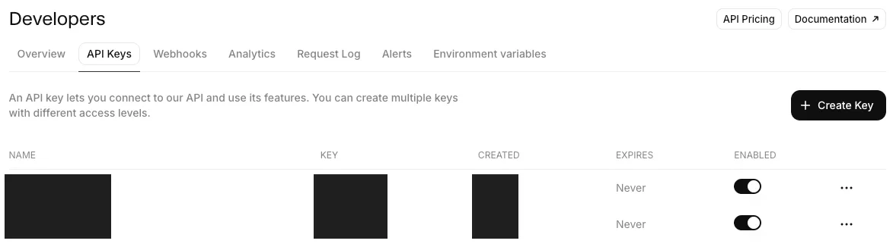
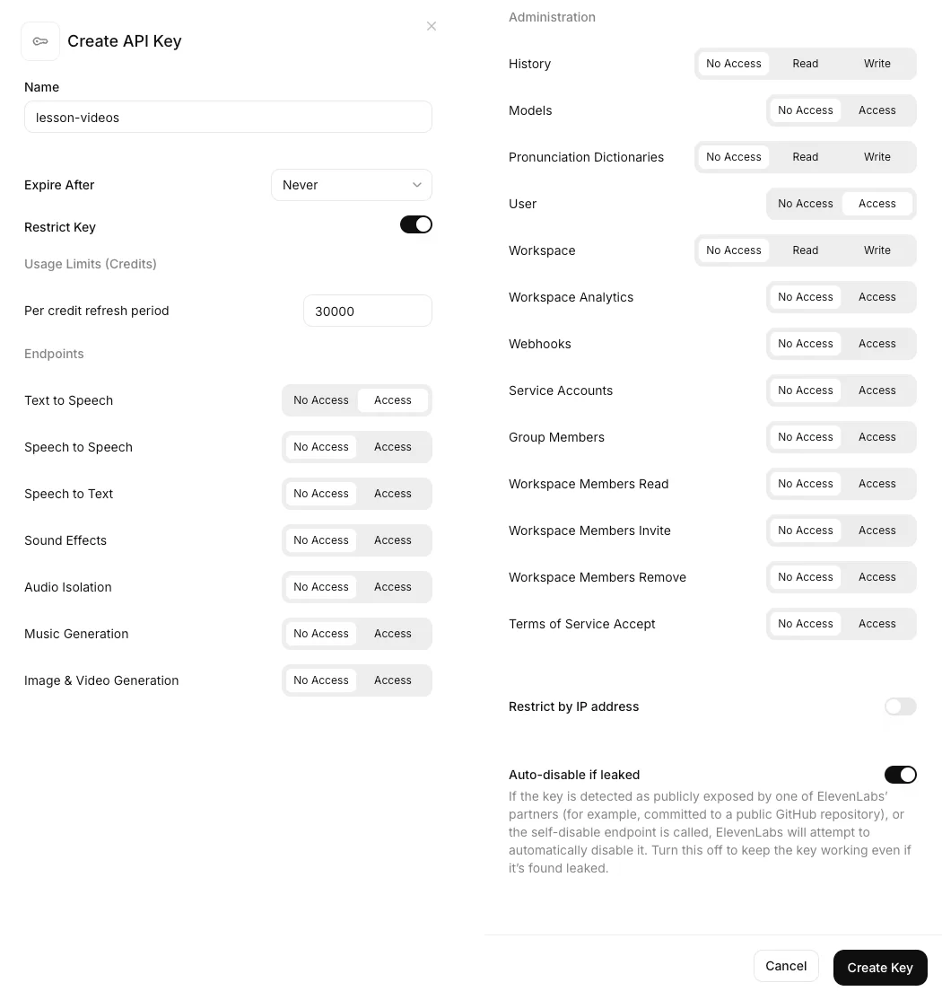

# ElevenLabs key, step by step

ElevenLabs gives the most natural narration voice. Without it, lesson-videos uses a free Microsoft voice, so this is optional.

## Before you sign up: pick a plan

- **Free plan:** 10,000 characters a month, about one 5-minute video. Free-plan audio is for non-commercial use, a published video's title must include "elevenlabs.io", and the free plan must use a personal email address.
- **Starter:** $6/month for 30,000 characters (about four videos) and a commercial licence. You can cancel after the unit.
- Read ElevenLabs' use policy (https://elevenlabs.io/use-policy) yourself: it restricts use by government entities without authorization. Whether that applies to you is your call.

## Make the key

1. Open https://elevenlabs.io/app/developers/api-keys and sign up or sign in.

   

2. Click **Create Key**.
3. Name it `lesson-videos`.
4. Leave **Restrict Key** on. Set **Text to Speech** to **Access**, and further down, under Administration, set **User** to **Access** (so lesson-videos can show your remaining credits). Leave everything else on **No Access**.
5. Optional but recommended: in **Per credit refresh period**, type a limit (for example 30000) so the key can never spend more.

   

6. Click **Create Key**, then **Copy**. The key is shown only once.

## Save it

- **In Claude Code:** right after clicking Copy, type `/lesson-videos:setup` and tell Claude you copied your ElevenLabs key. It saves it with `keys paste elevenlabs` without ever showing it, and clears your clipboard. (Don't paste the key into the chat.)
- **In Cowork:** paste it into your keys file and attach it zipped. See [the keys file](keys-file.md).
