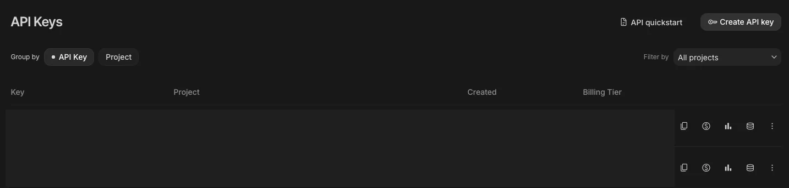
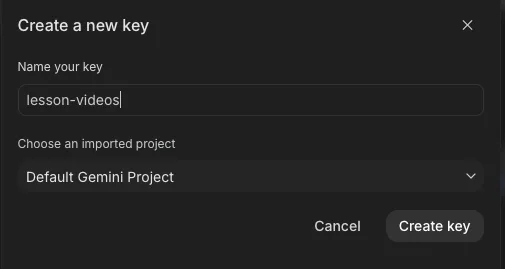
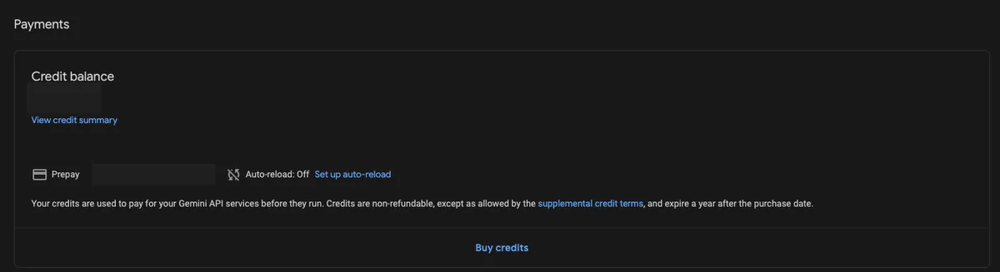
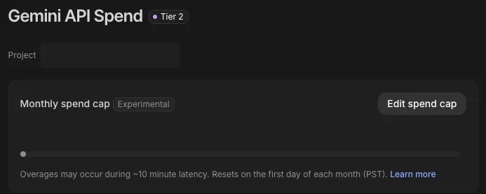

# Google Gemini key, step by step

A Gemini key lets lesson-videos add soft background music and a few short AI-animated clips made from your photos. It's optional: videos work without it.

## Before you start: the cost

- Google has no free tier for music and clips. You turn on billing and make a **$5 minimum prepayment**.
- About **$0.08 per music track** and **$0.40 per 8-second clip**: roughly $2–3 for a whole unit.
- Use a **personal** Google account. School accounts often have AI Studio turned off.

## Make the key

1. Open https://aistudio.google.com/api-keys and sign in. Accept the terms if asked.

   

2. Click **Create API key**, name it `lesson-videos`, keep the suggested project (or let it create one), and click **Create key**.

   

3. Click **Copy** next to the new key.

## Turn on billing

4. Open https://aistudio.google.com/billing (or click **Set up billing**), link a billing account, then click **Buy credits** and add the $5 prepayment.

   

## Set a spend cap

5. Open https://aistudio.google.com/spend, click **Edit spend cap** and set a monthly cap, for example $10. Google stops charging once it's reached.

   

Billing is only confirmed the first time music or a clip is made, because testing it costs money.

## Save it

- **In Claude Code:** right after clicking Copy, ask Claude to "save my Gemini key from the clipboard". It runs `keys paste gemini`, which saves the key without showing it and clears your clipboard. Or run `/lesson-videos:setup`, which opens a small file to paste the key into.
- **In Cowork:** paste it into your keys file and attach it zipped. See [the keys file](keys-file.md).
