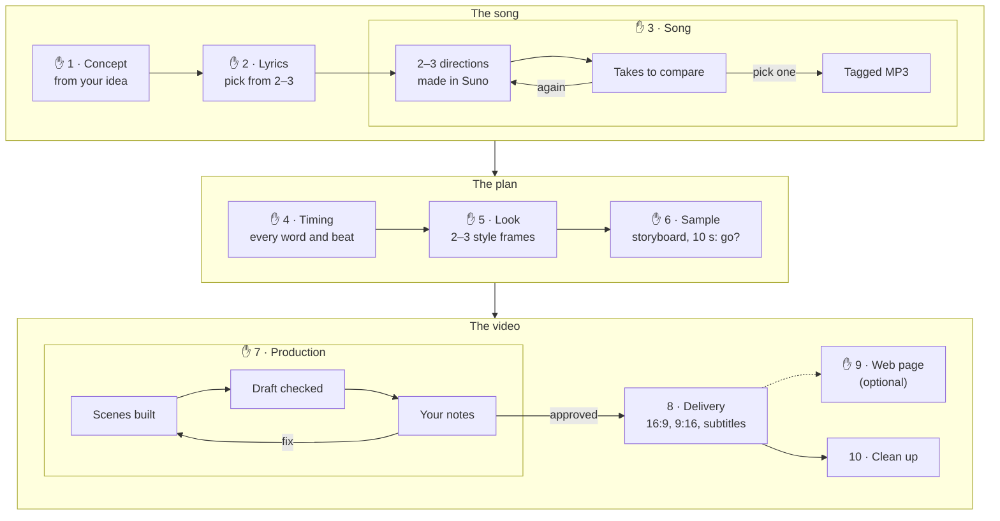
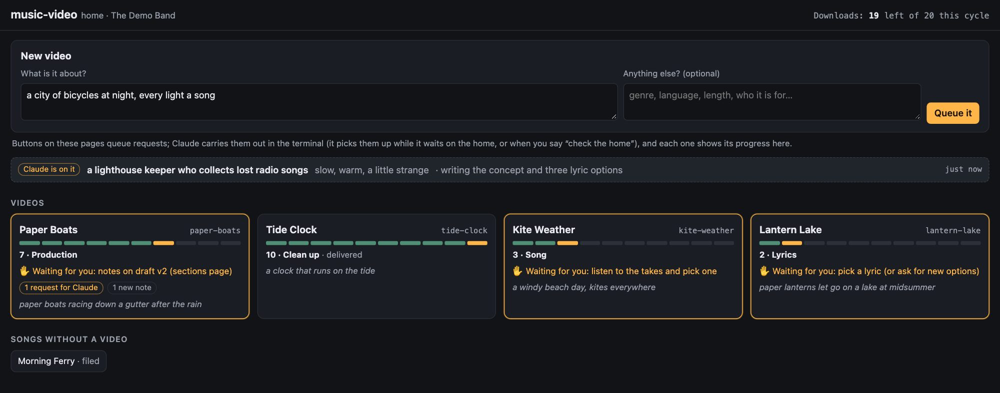
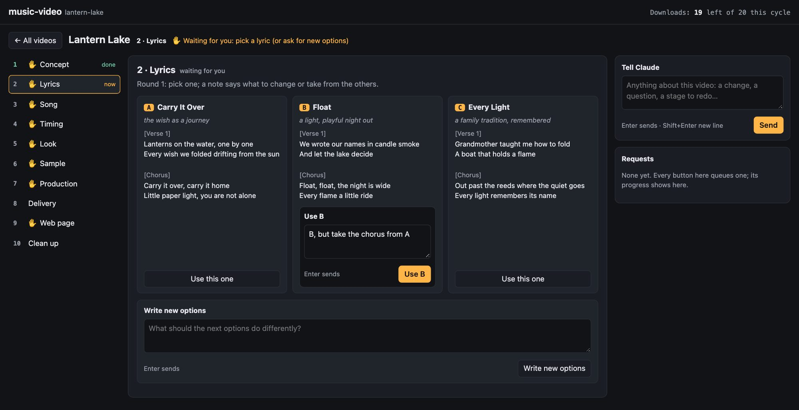
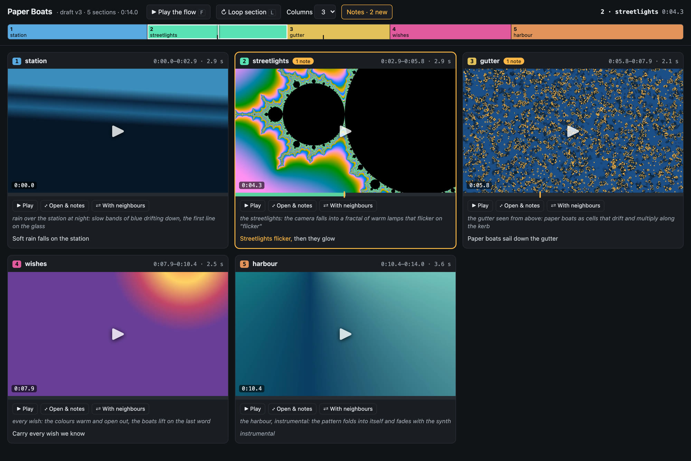
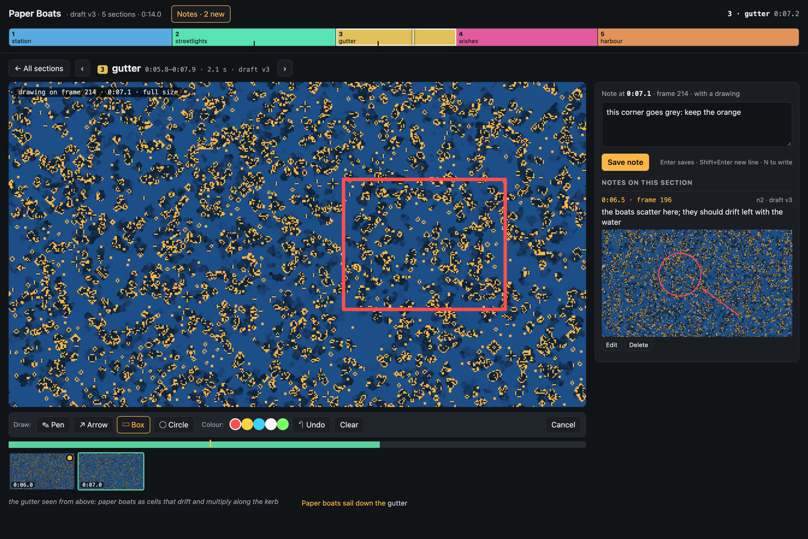
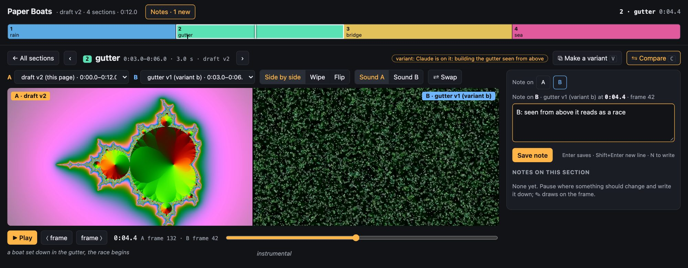
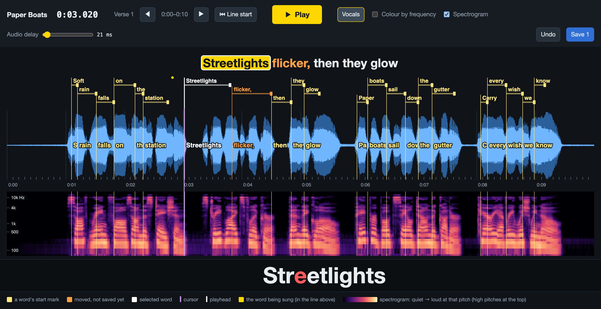

# music-video

Turn a theme into a finished music video with Claude Code: lyrics, a song made in your own Suno account, word-level
timings, and a code-rendered 2D/3D video with subtitles, a 9:16 cut and a thumbnail. You approve every stage.

> **Licences to know first.** The videos are rendered with [Remotion](https://www.remotion.dev). Remotion is free
> for individuals and companies of up to 3 people; larger companies need a Remotion company licence
> ([remotion.dev/license](https://www.remotion.dev/license)). The licence is between you and Remotion. Songs are
> made in your own Suno account under Suno's terms for your plan. The plugin itself is MIT; bundled assets are
> listed in [THIRD_PARTY_NOTICES.md](./THIRD_PARTY_NOTICES.md).

## What you get

- **A home page** for every song and video: where each one is, what is waiting for you, and buttons for your
  decisions (pick a lyric, send the directions to Suno, use a take, approve a stage) that Claude carries out.
- **A song:** 2–3 lyric options side by side, 2–3 musical directions created in Suno, a table of takes to listen
  to. Only the take you name is downloaded.
- **Timings:** every sung word timed (vocal separation + forced alignment, repaired against a transcription), plus
  tempo, beats, sections and big moments. A karaoke preview lets you check sync before any video work, and the [timing editor](#fixing-word-timings-by-eye-and-ear) lets you drag any word that is off onto where it is sung.
- **A video:** a written look, a storyboard with a reason for every cut, real scenes in React (2D, or 3D with the
  bundled kit: camera rigs on the song clock, extruded 3D lyrics, CC0 models), motion blur by sub-frame averaging,
  subtitles, and automatic checks (black, flash or frozen frames, sync, size) before you see anything.
- **Deliverables:** the 16:9 full song, a 9:16 cut, a thumbnail, and `.lrc`/`.srt`/`.vtt` lyrics.

## How it works

You bring an idea; the `make` skill takes it to a finished video in ten stages. At every ✋ Claude stops, shows you
what it made and waits: nothing moves on until you approve, and you can send any stage back with notes.



| Stage | Claude does | You decide |
|---|---|---|
| 1 · Concept | talks through the subject, audience, feeling, genre, language and length; proposes a concept | the concept |
| 2 · Lyrics | writes 2–3 complete options from different angles; checks the title isn't a known song | the words and the title |
| 3 · Song | writes 2–3 musical directions, fills Suno's form in your Chrome, reads it back, creates, lists the takes | which take to keep, or another round |
| 4 · Timing | times every sung word, maps tempo, beats, sections and big moments, opens a karaoke preview | whether the words land; fix any that don't in the timing editor |
| 5 · Look | writes 2–3 looks (palette, type, motion, 2D or 3D) and renders real frames of each | the look, or a merge |
| 6 · Sample | writes the storyboard and the cuts, builds the scenes a 10 s sample needs, checks every transition | go or no go; the subtitle style |
| 7 · Production | builds every scene (up to four agents at a time), renders and checks a full draft, answers every note | notes on each draft, until it is right |
| 8 · Delivery | renders the finals, checks them, picks thumbnail frames, writes a description if you want one | uploading is yours |

**Picking up later:** every video keeps its stage in `video.yaml`, a dated `JOURNAL.md` of what was shown and what
you said, and `NOTES.md` with your notes. Ask Claude to continue the video and it carries on from where it stopped,
in a new session or on another day.

## The home

`home --open` (Claude starts it for you) is one page on your own computer with every song and video and its
stage. It is where you decide; Claude, in the terminal, does the work.



- **New video:** type what it is about (and anything else: genre, language). Claude writes the concept and two or
  three lyric options from it.
- **Each video** opens on its ten stages: which are done, which one is now, what is waiting for you, and the pages
  that belong to it (the karaoke preview, the timing editor, the look frames, the sections page, the review page,
  the finals).
- **Lyrics** side by side: **Use this one**, with a note if you like ("take the chorus from A"), and Claude merges.
  Or ask for new options.
- **The song:** tick the musical directions and **Send to Suno**; the takes come back as a table with a link to each
  in Suno. Listen there, then **Use this take** here: that names the take, and only it is downloaded (counted
  against your plan's downloads).
- **Approve** a stage (with a note), or **Tell Claude** anything about the video.



Every button queues a **request** in the video's folder (`requests/`); nothing runs from the page itself. Claude
keeps a watch on them while the home is open (`requests --wait`), says in the chat what it picked up, and the page
shows each one's progress: waiting for Claude, Claude is on it (with what it is doing), done. You can still say
everything in the chat instead: the page and the chat are two ways to answer the same questions.

## The skills

| Skill | Use it for |
|---|---|
| `music-video:make` | the whole process above: *"make a music video about a night drive through the city"* |
| `music-video:song` | one song without a video: draft the settings, create it in Suno, compare takes, download and file the one you name (alone or into an album) |
| `music-video:ingest` | a song you downloaded from Suno by hand, filed and tagged like the others |

Claude picks the skill from what you ask; you can also name one.

## What Claude will and won't do

- **Your Suno account, your downloads.** Claude downloads only a take you named, and records it against your
  plan's downloads first; when they are used up it stops. It never solves a captcha or uses an unofficial API.
- **Original songs only:** no lines or titles from existing songs.
- **No generated images or video.** Every picture is drawn in code. Outside assets (models, textures, fonts) are
  CC0 or OFL only, listed in the video's `SOURCES.md`.
- **Checked before you see it.** Every render goes through `qc` (size, length, BT.709 colour, black, flash or
  frozen frames, flicker, pops, stray hard cuts, camera jitter, sync) and Claude looks at its frame sheet before showing it. A render that fails is fixed, never shown.
- **It never uploads or publishes.** Posting the video is yours; Claude can draft the description and chapters,
  and reminds you of the platform's AI-content disclosure.

## Giving notes

Each draft opens on the **sections page** (`sections <id> --open`), a page on your own computer laid out by the
video's scenes:



- **Every section on one screen**, in song order, with a strip along the top that shows each one to scale on the
  song. Play any section on its own, **Play the flow** to run them in order, or **With neighbours** to see how a
  section joins the ones around it.
- **Open a section** to watch it large: frame stepping (`,` and `.`), a filmstrip with a frame a second, its lyrics
  lighting up as they are sung, and the scene's note from the storyboard.
- **Notes on the frame.** Start typing and the video pauses; the note keeps the frame on screen (its song time,
  frame number and draft). **Draw on frame** (D) brings up that frame at full size to circle, box, arrow or scribble
  on the problem; the drawing is saved with the note.
- The notes stay in your video's folder (`notes/`). When you are done, Claude reads them (`notes <id>`) as if you had
  typed them in the chat, looking at every frame you drew on, and writes them into the next round.



*A demo song, "Paper Boats", whose five scenes are ffmpeg's own pattern generators (a gradient, a fractal, a game of
life), with two notes left on it.*

**Compare** (C) in an opened section plays it in two versions at once, on one clock: this draft, an earlier draft,
a clip of the scene, or a **variant**. Claude builds two variants of a risky scene on its own (a new technique, the
big moment), and **Make a variant** (V) asks it for one, with what to try. Side by side, a wipe, or flipping; frame
by frame; and a note can go on either side, so Claude knows which version you mean.



The **review page** (`review <id> --open`) keeps every version of every scene. It plays any two of them together,
lined up on the song: side by side, with a wipe, or flipping between them, frame by frame if you like. **Copy
timecode** gives you a line such as `relay v3 vs relay v2 at 1:42.3` to paste into a note.

Your notes are numbered in `NOTES.md` under the round they belong to, and the next draft answers each one: what
changed, or why not. Claude sorts them into errors and taste. For an error that no check caught, it proposes a new
check; a taste you state ("camera moves stay smooth; never stop and jump") goes, with your OK, into `taste.md` in
your project folder, and is read before every later render, in every video.

## Fixing word timings by eye and ear

Subtitles that light up each word as it is sung need every word's start right to about a tenth of a second.
Alignment gets most words there; the rest (a whispered word, a word after a long held note) you fix in the
**timing editor**, a page on your own computer. The make skill offers it with the karaoke preview, or run
`edit-timing <id> --open`.



*A demo line (spoken by macOS `say` over a synth chord), with "flicker," just moved and "Streetlights" selected.*

- **Ten seconds at a time:** the vocal waveform with 0.1 s ticks, the beats as dots along the top, and a mark at
  each word's start with a bar to its end. The line being sung is shown above, and the word being sung large below.
- **A spectrogram under the waveform** shows which pitches sound when, so a word's first sound is easy to place:
  an s, f or sh is a haze high up that can start several frames before the vowel, a p, t or k a thin vertical line,
  a vowel or an m, n or l a stack of bright bands low down. A breath before a phrase is a faint haze, not the start.
- **Drag a mark** (in the waveform or the spectrogram) to move a word: it keeps its length. Drag the handle at the
  end of its bar to move its end. Arrow keys nudge the selected word by 10 ms (Shift: 100 ms).
- **Listen around it:** Space plays from the cursor, B goes back to the start of the line. **Vocals** switches the
  sound and the pictures to the separated voice alone, without the band.
- **Audio delay:** Bluetooth headphones play the sound about 0.2 s late. Slide it while playing until the
  playhead meets the sound, so you judge words by ear where you hear them.
- **Save** writes one entry per moved word to the video's `timing-fixes.yaml`, then re-aligns and re-analyses the
  song with your fixes. The fixes stay with the video, so a new alignment never loses them, and Undo works until you
  save.

The page only answers requests from your own computer. **S** hides the spectrogram, **F** colours the waveform by
frequency, and the page's help lists every key.

## Requirements

- **macOS.** Windows is not tested yet (the commands avoid bash-only syntax so it can follow).
- **Claude Code**, and **Chrome with the Claude in Chrome extension**, signed in to **your own Suno account**
  (a paid plan, for downloads and commercial terms).
- **uv** ([install](https://docs.astral.sh/uv/getting-started/installation/)), **Node 20+** and **ffmpeg**
  (`brew install ffmpeg`). `doctor` checks them and says what is missing.
- About 4 GB of disk in your cache folder: the video engine's packages (1.7 GB) and the alignment models.

## Install

In Claude Code:

```
/plugin marketplace add DanielLandi/plugins
/plugin install music-video@daniellandi
```

Then ask: *"make a music video about a night drive through the city"*. The `music-video:make` skill runs
`doctor` (installs the video engine once) and `init` (asks your artist name and your Suno plan's billing day and
downloads per cycle), then starts at the concept.

## Where things go

| Folder | Default (macOS) | What's in it |
|---|---|---|
| **Project** | `~/Documents/Music Videos/` (`init --path` for another) | `config.yaml`, `specs/<id>.yaml` (one per song), `albums/<album>.yaml`, `videos/<id>/` (each video's documents and scene code). Small: keep it in git if you like. |
| **Install** | `~/Library/Application Support/music-video/` | `engine/`: the engine (Remotion, its browser, compilers, three.js), installed once by `doctor`; the alignment models; `avatars/`: the CC0 sample characters (about 64 MB, with their `SOURCES.md`); `engines/<checkout>/`: an engine per git checkout of the plugin, its packages hard-linked from any installed engine with the same `package-lock.json` (`engine/` or another checkout's); `doctor` removes the engine of a checkout that no longer exists (a removed worktree) unless a command is using it |
| **Work** | `~/Library/Caches/music-video/work/<id>/` | everything regenerable: timings, vocals, previews, renders, checks. `clean <id>` frees it. In a git worktree of the project: `.lanes/<worktree>/<id>/`, which starts as a copy of the main checkout's timings (`public/`, vocals, transcript, aligned words, beats, `loop/`; never renders, checks or reviews), so the worktree need not align again. |
| **Results** | `~/Movies/Music Videos/` (`results_dir`) | `<id>/`: the final videos, thumbnail, subtitles, the song and `web/` (the live page); `albums/<album>/`: tagged MP3s and `manifest.json`; `.lanes/<worktree>/<id>/`: a git worktree's own video finals, hidden from the library (its songs still go to `<id>/`) |

Nothing is stored in the plugin folder, which is replaced on every update.

## How the Suno steps work

Claude drives suno.com in your own Chrome, signed in as you, through the Claude in Chrome extension. There are no
unofficial APIs, no cookie replay and no captcha solving: when Suno asks "Verify you are human", Claude stops and
asks you. Every form is read back and compared with the spec before Create. A download is recorded against your
plan's downloads (`downloaded`) before the Download click, and only for a take you named.

## Commands

The skills run these for you; each is `uv run "${CLAUDE_PLUGIN_ROOT}/scripts/music-video.py" <command>`.

| Command | What it does |
|---|---|
| `doctor` | check uv, Node, ffmpeg; install the video engine and the character avatars into the install folder (`--no-avatars` skips them; after a failed avatar download it waits 24 h before trying again, and `avatars install` tries now) |
| `avatars` | the four CC0 VRoid sample characters for `vrm` videos: `status`, `install`, or `add <file>` for a copy you downloaded (checked against the pinned checksum) |
| `bakeoff` | character engines side by side: `new <id>` starts one take per engine (raw, vrm, cartoon) of a fixed brief, kept as review-page variants; `record` keeps the verdict and model in `bakeoffs.md`; `last --model <id>` says when a new model should be checked; `clear` removes the takes |
| `init` | create or point at your workspace |
| `new`, `validate`, `round`, `downloaded`, `status` | song specs, Create rounds, the download budget |
| `ingest`, `album` | file a downloaded MP3, tagged, into its results or album folder; rebuild an album's `manifest.json` |
| `align`, `analyze`, `preview` | word timings, the song map, a karaoke preview |
| `edit-timing` | drag words onto the vocal waveform and its spectrogram to fix their timing, then save |
| `new-video`, `typecheck`, `paths`, `clean` | start a video from the template, check its code, print its folders, free its working files |
| `placeholder` | a silent stand-in song for a video whose song does not exist yet (`--seconds`, `--bpm`), so the picture can come first; the real song replaces it |
| `loop`, `web` | a seamless audio loop of a song; a live web page of a video (looping, optional sound) |
| `studio`, `still`, `stills`, `render`, `blur`, `board` | Remotion Studio, stills, renders, motion blur, the transition board |
| `mux`, `qc` | add the song to a silent render (with any lifts in the video's `song-fixes.yaml`); check a render |
| `home`, `requests` | one page with every song and video, its ten stages and buttons for your decisions; `requests` lists what you asked for there, for Claude to carry out (`--wait` waits for the next one) |
| `sections`, `notes` | every section of the newest draft on one page, each playable alone or in order; open one to watch it large, leave notes on its frames, with drawings, compare it with another version, or ask for a variant; `notes` prints the notes for the next round |
| `version`, `review` | keep each checked render or still as a numbered version of its scene (`--variant b` for a variant); a local page that plays any two versions in sync (side by side, wipe, flip) |
| `library` | everything in your results folder (videos, songs, lessons) as one page any phone, tablet or TV browser on your home network can play from; `library install` keeps it running from login (macOS) |

## Song generators and albums

A song spec names its generator (`generator: suno`), with that generator's settings in its own block; Suno is the
first, and everything specific to it lives in `skills/song/references/generators/suno/`. Songs can belong to an
album: `albums/<album>.yaml` gives the title, year and cover, and can credit a different artist and album name per
style; the album's folder in results holds the tagged MP3s and a `manifest.json` for a site or player.

## Your library at home

`music-video library install` (macOS) starts a small read-only web server at every login and prints its address,
for example `http://your-mac.local:8642/`. Open it on a phone, a tablet or a TV's browser on the same network: every
project in the results folder, newest first, with its thumbnail, subtitles, a Loop button (for a film left playing
on a TV) and Play all; songs play in the page; a live web page is linked. AirPlay or cast from the player to send a
video to the TV. Working folders (any folder whose name starts with `_` or `.`, such as a lesson's `_source`) are
never listed or served. It is open to anyone on your home network, with no password: do not forward its port to
the internet. It answers only requests addressed to the computer by its address or its `.local` name (so a website
cannot read it through a browser at home). `library` prints the address, `library serve` runs it in the foreground (any platform), `library
uninstall` stops it starting at login. After a plugin update, run `library install` again to refresh its copy.

## The picture before the song

A video can start before its song exists (a proof of concept, a test of a look, visuals the song is written to
later). Give it a silent placeholder song:

```bash
uv run "${CLAUDE_PLUGIN_ROOT}/scripts/music-video.py" new-video skate-test --placeholder 10
uv run "${CLAUDE_PLUGIN_ROOT}/scripts/music-video.py" placeholder skate-test --seconds 30 --bpm 96
```

It writes `placeholder: {seconds: 10, bpm: 120}` into the video's `video.yaml` and fills its public folder as
`align` and `analyze` would: a silent `song.mp3`, a `timing.json` with no words, and an `analysis.json` with a
steady beat grid (a downbeat every 4 beats), 8-bar sections named Part 1, Part 2… and a flat energy, each marked
`"placeholder": true`. `studio`, `still`, `stills`, `render`, `blur`, `board` and `typecheck` then work as usual;
`placeholder` again changes the length or tempo, and `clean` loses nothing (the files come back from `video.yaml`).

`qc` checks a placeholder video's renders without a song: every picture check runs, the audio and lyric checks
print `SKIP`, and a `placeholder` line says the render is not a final (it fails if the render sits in the video's
results folder). For a clip with no song and no placeholder at all, `qc --silent` does the same.

When the song is made, file it under the video's id as usual (`ingest`); the first `align` (or `analyze`, `mux`,
`qc`) removes the placeholder's files and sets `video.yaml` back to `placeholder: null`. Then `align` and
`analyze` write the real timings, and scenes timed to the placeholder's grid move to the song's sections.

## The live web page

`web <id>` builds a static page that draws the video's `web.tsx` live in the browser with Remotion Player, on a
loop, with an optional seamless audio loop (`loop <song>`) behind a sound button. Copy `results/<id>/web/` to any
static host.

## The 3D kit and motion blur

`@mv/kit/three` gives a full-frame `<Stage>`, a `<CameraRig>` whose keys sit on the song clock (land a key on each
sung word), extruded lyrics (`<Text3D>`, `<Letters>`), a `<SkyDome>`, a `<Model>` loader for the bundled CC0 GLBs,
a NaN-safe post chain, and a finishing pass: a film-print post (`FinishPost`), paper with thickness, carved frames
and relief maps that give flat things depth. Lyrics drawn on things (letters, signs, screens) use canvas surfaces
whose fonts are loaded before a frame is captured. `blur` renders sub-frames and averages them with a centred shutter (32 samples gives
film-like blur on camera moves). `render` and `blur` kill a render that shows no progress for 15 minutes and start
it again (`--stall`, `--retries`).

## Licence

MIT for the plugin's own code. Third-party code, models and fonts: [THIRD_PARTY_NOTICES.md](./THIRD_PARTY_NOTICES.md).
